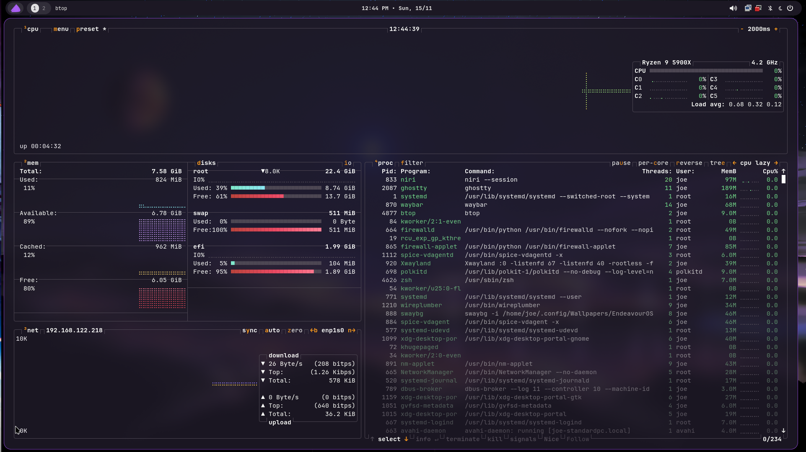

# Currently active maintained editions

## Niri

**Link to Sources:** https://gitlab.com/trungdaohieutrung/endeavouros-niri

**Raw isomode script link:** https://gitlab.com/trungdaohieutrung/endeavouros-niri/-/raw/main/setup_niri_isomode.bash

---

## Sway

**Link to Sources:** https://github.com/EndeavourOS-Community-Editions/sway

**Raw isomode script link:** https://raw.githubusercontent.com/EndeavourOS-Community-Editions/sway/refs/heads/main/setup_sway_isomode.bash

---

## openbox

**Link to Sources:** https://github.com/EndeavourOS-Community-Editions/openbox

**Raw isomode script link:** https://raw.githubusercontent.com/EndeavourOS-Community-Editions/openbox/refs/heads/main/setup_openbox_isomode

---

