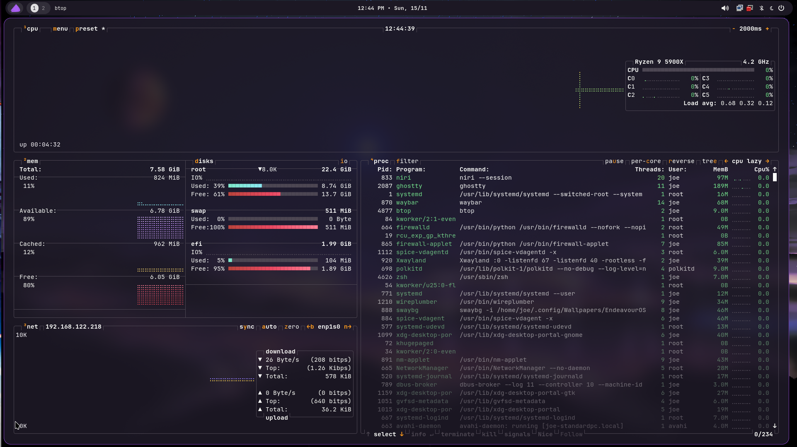

# Currently active maintained editions

## i3 - classic EndeavourOS edition

**Info:** The classic EndeavourOS i3 setup, classic tiling wm running on X11 (xorg), using rofi for several menus, and easy to hack scripts to make it a fully working Desktop.

**Link to Sources:** https://github.com/endeavouros-team/endeavouros-i3wm-setup

**Raw isomode script link:** https://raw.githubusercontent.com/endeavouros-team/endeavouros-i3wm-setup/refs/heads/main/i3_install_isomode

---

## Niri

**Info:** Niri is a scrollable-tiling Wayland compositor: windows are arranged in an infinite horizontal strip of columns, and you scroll left or right to reveal more of them rather than having the layout reflow. Each column holds one window (or a stack), so opening a new window appends a column to the strip instead of shrinking everything to fit the screen.

**Link to Sources:** https://gitlab.com/trungdaohieutrung/endeavouros-niri

**Raw isomode script link:** https://gitlab.com/trungdaohieutrung/endeavouros-niri/-/raw/main/setup_niri_isomode.bash

---

## Sway

**Info:** Windows are set to tile by default in Sway. This can be changed to stacking, where only the focused window in the container is displayed. You get a "list" of windows at the top of the container.

**Link to Sources:** https://github.com/EndeavourOS-Community-Editions/sway

**Raw isomode script link:** https://raw.githubusercontent.com/EndeavourOS-Community-Editions/sway/refs/heads/main/setup_sway_isomode.bash

---

## openbox

**Info:** Background handled by nitrogen, Gtk3 theme handled by lxappearance-obconf, Filebrowser = Thunar, Default Terminal-Emulator = xfce4-terminal, Text-Editor = xed, Application Launcher = Rofi, composition (transparency) picom see here: picom-settings

**Link to Sources:** https://github.com/EndeavourOS-Community-Editions/openbox

**Raw isomode script link:** https://raw.githubusercontent.com/EndeavourOS-Community-Editions/openbox/refs/heads/main/setup_openbox_isomode

---

